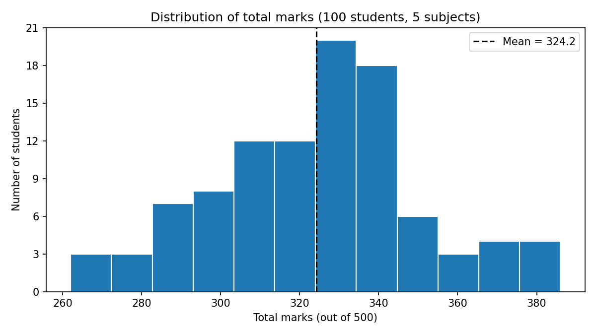
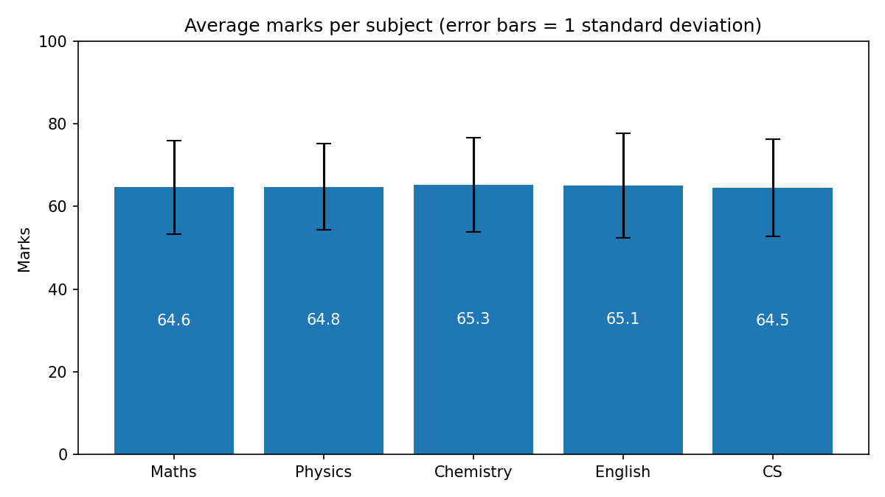
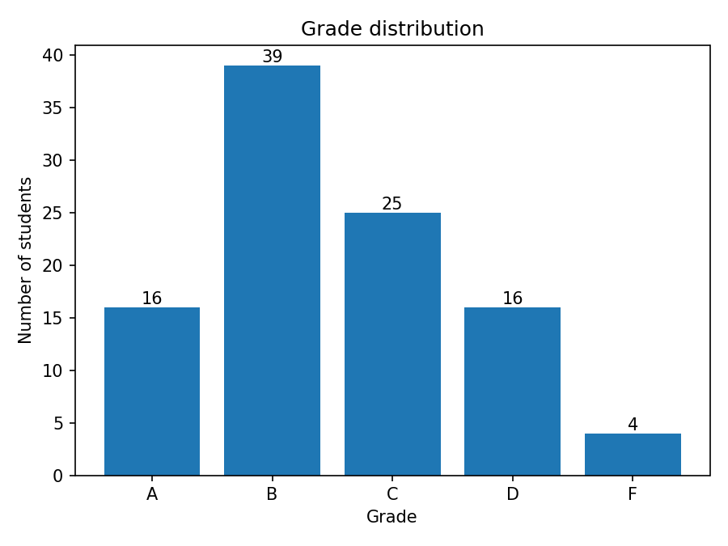

# Student Marks Analyzer (NumPy)

A beginner-friendly NumPy project that analyzes the marks of 100 students across 5 subjects using **vectorized operations only** (no Python loops over the data).

> **Note:** the data is synthetic (normal distribution, fixed seed), so the findings describe this practice dataset, not real students.

## What this project covers

| Stage | Topic | NumPy skills practiced |
|---|---|---|
| 1 | Create the dataset | `default_rng`, `normal`, `clip`, `round`, `astype` |
| 2 | Basic statistics | `mean`, `median`, `std`, `max`, `min` with `axis` |
| 3 | Finding students | `argmax`, `argsort`, boolean masks, `any`, `all`, `flatnonzero`, `argwhere` |
| 4 | Broadcasting | z-scores, `keepdims`, `minimum`, `copy` |
| 5 | Percentiles and grades | double `argsort`, `searchsorted`, `digitize`, `select` |
| 6 | Visualization | matplotlib histogram and bar charts |

The notebook also includes small experiments on how `astype(int)` truncates, how `np.round` rounds half to even, and why the order of clip/round/convert matters.

## Key findings

- **Dataset:** 100 students x 5 subjects, overall mean 64.85, mean total 324.24 (median 327).
- **Subjects:** Chemistry has the highest average (65.28) and CS the lowest (64.51). English varies the most (std 12.63), Physics the least (std 10.43). The averages differ by under 1 mark, so this is noise (all subjects were generated from the same distribution).
- **Topper:** Student 28 with 386 marks. Top 5: Students 28, 63, 65, 91, 84.
- **Failures:** 1 student failed a subject (Student 59, English, 34 marks; pass mark 35).
- **High scorers:** 8 students scored above 90 in at least one subject; CS has the most (3).
- **Grace marks:** adding 5 to the weakest subject (CS) raises its average from 64.51 to 69.45, with 2 students capped at 100.
- **Grades:** A: 16, B: 39, C: 25, D: 16, F: 4. Averaging five subjects shrinks the spread, so grade bands have to fit the data.

## Charts







## Things I learned

- `astype(int)` truncates toward zero, so round first. Pipeline order: **clip -> round -> int**.
- `axis=0` gives one value per column, `axis=1` one value per row. Always check `.shape`.
- Counting *students* and counting *scores* are different questions and need different `axis` choices.
- Ties break naive rankings; `searchsorted` gives tie-safe percentile ranks.
- Broadcasting aligns shapes from the right; `keepdims=True` makes per-row statistics broadcast correctly.
- Don't tell a story from noise: tiny differences between subjects are not findings.

## How to run

```bash
git clone <your-repo-url>
cd numpy-student-marks-analyzer

python -m venv .venv
source .venv/bin/activate        # Windows: .venv\Scripts\activate
pip install -r requirements.txt

jupyter notebook analysis.ipynb
```

Run all cells (`Kernel -> Restart & Run All`). Results are identical on every run because the random seed is fixed (`SEED = 42`).

## Project structure

```
numpy-student-marks-analyzer/
├── analysis.ipynb      # the full analysis, with explanations
├── README.md
├── requirements.txt
└── images/             # charts used in this README
```
